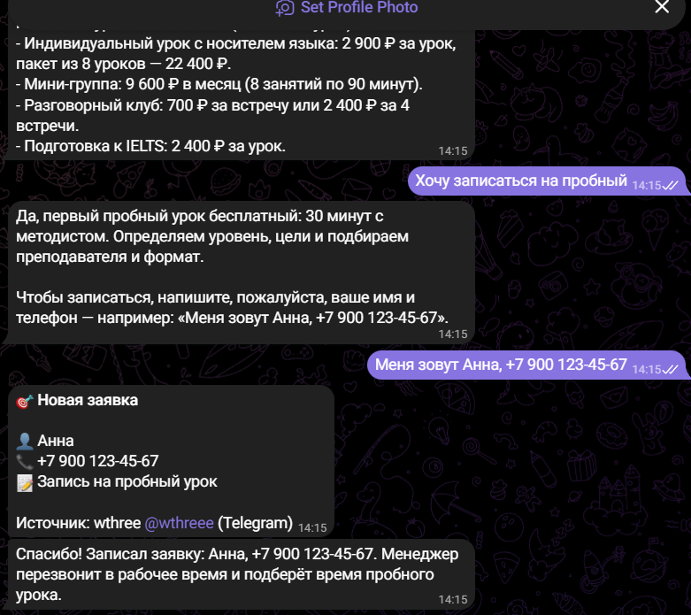
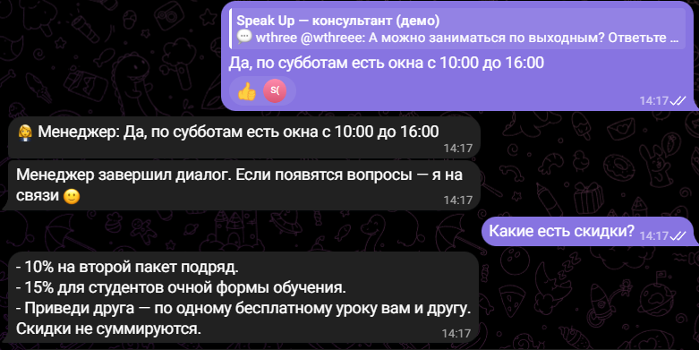
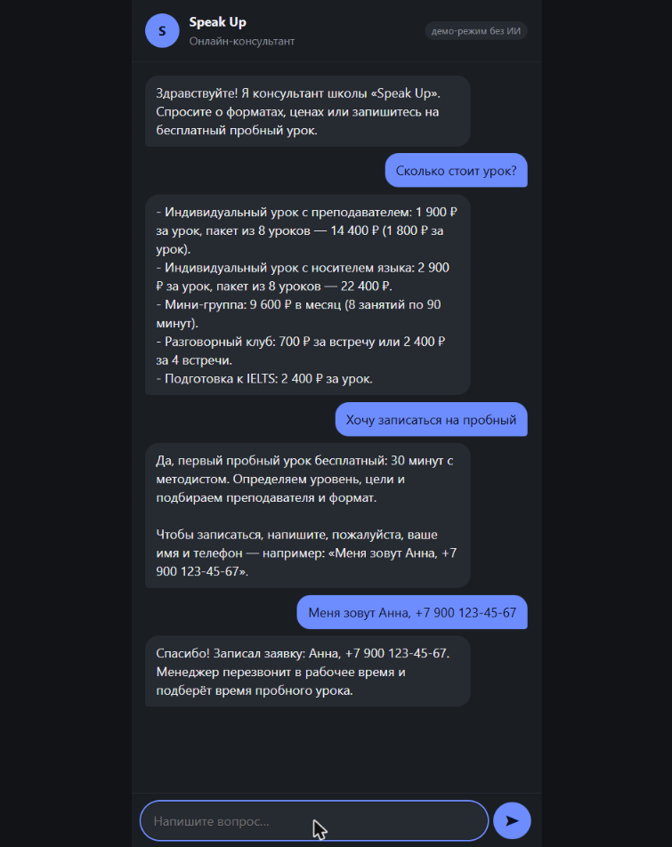

# 🧠 AI Assistant for Businesses: Telegram + Website Chat

**English** · [Русский](README.ru.md)

An assistant that answers customers 24/7 from the company's knowledge base, books them in and hands complex conversations over to a human manager. It works in a Telegram bot and in a website chat at the same time. Powered by the Claude API.

The demo is an online English school. For another business, just replace the files in `knowledge/`.

> The demo knowledge base and UI are in Russian. Any language works — the assistant answers in the language of the knowledge base and the customer.

<p>
  
  
</p>
<p>
  
</p>

Screenshots were taken in demo mode (no Claude API key): answers come from the knowledge base via keyword search. With a key, the same flows are handled by Claude.

## Features

**For customers**
- Answers questions about prices, formats, discounts and policies — **only from the knowledge base**, no made-up facts
- Books customers in: asks for a name and phone number and saves a lead
- Hands the conversation over to a human on request, on complaints or contract questions
- Remembers the conversation context

**For managers**
- Leads arrive in Telegram instantly
- Handed-over conversations come with a short summary; the manager replies **by replying to the message in Telegram**, and the bot stays silent meanwhile
- "Hand back to bot" button, `/leads` command for recent leads

**Under the hood**
- Claude API with `save_lead` and `handoff_to_manager` tools (`strict: true` — arguments always match the schema)
- The knowledge base is plain markdown, placed in the system prompt with **prompt caching** (paid once per 5 minutes, not on every message)
- Append-only conversation history: caching keeps working; when the knowledge base changes or after a day of silence, a new conversation simply starts
- **Cost limits**: at most 20 messages per hour per customer, a fresh conversation after 60 messages
- Automatic retry on a fallback model if a request is declined by safety filters (`fallbacks: "default"`)
- **Demo mode without an API key**: keyword search over the knowledge base — runs and demos for free
- 14 automated tests, including Claude's tool-use loop against a mocked API

## Tech stack

Node.js 24 · TypeScript · [Claude API](https://docs.claude.com) (`@anthropic-ai/sdk`) · grammY · Fastify · SQLite (`node:sqlite`) · `node:test`

## Structure

```
knowledge/               # knowledge base: markdown, "## Question" sections
src/
├── index.ts             # entry point: website chat + Telegram bot
├── assistant/
│   ├── claude.ts        # Claude assistant: request, tools, tool-use loop
│   ├── prompt.ts        # system prompt with rules and the knowledge base
│   └── demo.ts          # demo mode without AI: knowledge base search
├── chat-service.ts      # conversations, limits, leads, handoff
├── bot.ts               # Telegram: customers and managers
├── web-chat.ts          # website chat (page + API), embeddable via iframe
├── knowledge.ts         # loading and parsing the knowledge base
└── db.ts                # SQLite: conversations, messages, leads
```

## Running

Requires **Node.js 24+**.

```bash
npm install
npm start
```

Open http://localhost:3000 — that's the website chat. Without configuration it runs in demo mode.

To enable everything else, copy `.env.example` to `.env`:

| Variable | Purpose |
|---|---|
| `ANTHROPIC_API_KEY` | Claude API key — AI answers instead of demo mode |
| `CLAUDE_MODEL` | model; `claude-opus-5-5` by default, `claude-haiku-5-5` to save costs |
| `BOT_TOKEN` | Telegram bot token from @BotFather |
| `ADMIN_IDS` | managers' Telegram IDs (send `/myid` to the bot) |

```bash
npm test
npm run typecheck
```

## Embedding on a website

```html
<iframe src="https://chat.example.com/" style="width:380px;height:600px;border:0;border-radius:16px"></iframe>
```

## Running costs

Costs depend on the model and the size of the knowledge base. Thanks to prompt caching, the knowledge base is cheap: cached tokens cost about 10× less than regular ones. For a small business with a 3–5 page knowledge base and ~100 conversations a day, it's a few dollars a month on `claude-haiku-5-5`. Estimate on real conversations before launch.

**Possible extensions:** CRM or Google Sheets integration, importing the knowledge base from PDFs and websites, analytics of frequent questions, voice messages, payments.
